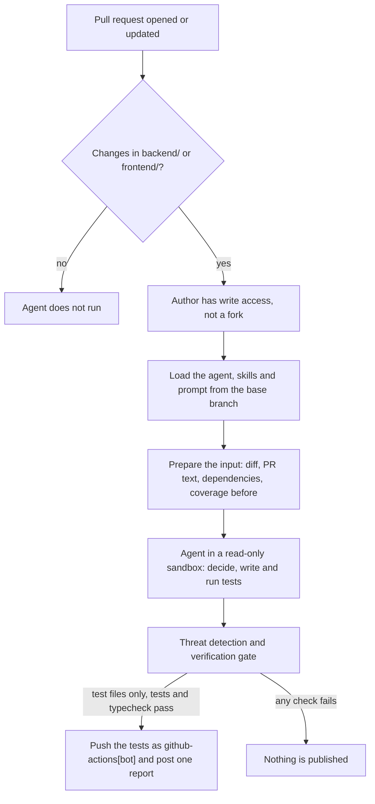
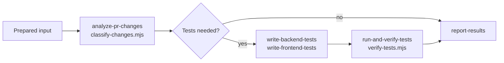

# Unit test agent for Taskly

This repository has an AI agent that writes and checks unit tests for the Taskly frontend and backend. It runs on GitHub with [GitHub Agentic Workflows](https://github.github.com/gh-aw/) (gh-aw) and Claude.

**What you see in a pull request.** When you open or update a PR that changes code, the agent:

1. decides, file by file, whether tests are needed and explains why;
2. writes or updates the tests and runs them;
3. after an independent check passes, pushes the tests to your branch as a `github-actions[bot]` commit;
4. posts one comment with its decisions, the tests it wrote, the test results and the coverage before and after.

If tests are not needed, you get the comment with the reason and no commit. If anything fails, nothing is published.

**Coverage on demand.** The same agent and skills can also scan existing code and open a draft PR with tests for the most valuable untested files.

**See it in action:** demo PR [#20] (a new feature, tested by the agent), the agent's coverage PRs [#11] and [#23].

## 1. Main technical decisions and rationale

| Decision | Rationale |
| --- | --- |
| **gh-aw with the Claude engine** | gh-aw provides a read-only agent, declared write operations ("safe outputs"), a network firewall and threat detection. Claude Code supports skills natively. |
| **Code for facts, the agent for judgment** | Collecting the diff, installing dependencies, classifying files, ranking coverage gaps and measuring coverage are done by workflow steps and small scripts. The agent decides what changed in behaviour, what to test and why a test fails. The scripts were added after the agent twice failed to measure coverage by itself. |
| **Independent check before publishing** | A gate (`.github/scripts/verify-agent-patch.sh`) applies the agent's patch to a clean checkout. It accepts test files only and no deletions. Tests and typecheck must pass on Node 24 (backend) and 22 (frontend), the versions in the Dockerfiles. The agent cannot influence this check, and any failure blocks publication. |
| **No tests that accept bugs** | The agent tests intended behaviour. It changes an existing test only if the PR title, description or a commit message states the new behaviour. Otherwise it reports a possible breaking change ([#15] vs [#17]). It reports suspected bugs instead of encoding them ([#6]). |
| **Runs only when code changes, then decides** | A `paths` filter skips PRs without code changes, which costs nothing. For code PRs the agent decides, with a reason, whether tests are needed ([#13]). |
| **One agent, two workflows** | The PR and coverage workflows share the agent, the write, run and report skills, the scripts, the setup and the gate. |
| **Plain CI next to the agent** | The agent is not CI. `ci.yml` runs typecheck, tests, Prettier and the script tests, with no AI. |
| **`claude-sonnet-5-5`, pinned; gh-aw v1.2.2 (stable)** | Good enough for writing tests at half the price of Opus, and reproducible. Features that exist only in gh-aw pre-releases are replaced by the gate. |

**Security**

- The agent can only read. Writing happens in a separate step, limited to one comment and pushes of test files (or one draft PR).
- The only secret is `ANTHROPIC_API_KEY`. A proxy holds it, and it is hidden from the agent.
- Code, comments and PR text are treated as data: a prompt injection in a code comment was ignored and reported ([#14]). The agent's instructions, skills and scripts come from the base branch, so a PR cannot change the agent that checks it.
- Firewall (`defaults` only), allowlisted shell commands, dependency install scripts disabled.
- Only same-repository PRs from people with write access trigger the agent. Fork PRs and bot commits do not.
- Actions are pinned to commit SHAs, containers by digest. Threat detection blocks publication on a finding. Spend limit, time limit and step limit cap the cost.

## 2. How to run the PR workflow and prerequisites

**Prerequisites**

- GitHub Actions enabled, with default workflow permissions set to read.
- A repository secret `ANTHROPIC_API_KEY`: an Anthropic API key with credits, ideally in a workspace with a spend limit.
- For the coverage workflow only: Settings → Actions → General → "Allow GitHub Actions to create and approve pull requests".
- To change the workflows: `gh extension install github/gh-aw --pin v1.2.2`.

**Running**

- **Pull requests**: open a PR that changes `backend/` or `frontend/`. The agent starts automatically and comments in about 5 minutes. When it pushes tests, GitHub asks a maintainer to approve the CI run on the bot's commit.
- **Coverage**: Actions → Coverage agent → Run workflow (choose the package and up to 3, 5 or 8 files), or `gh workflow run coverage-agent.lock.yml -f package=both -f max_files=5`.
- **Changing the agent or workflows**: edit the `.md` files, run `gh aw compile`, and commit the `.md` and `.lock.yml` files together. Open PRs pick up the change after their branch is updated with `main`.
- **Locally**: `npm test --prefix backend`, `npm test --prefix frontend`, and `node --test .agents/skills/*/scripts/*.test.mjs` for the scripts.

## 3. Where the custom agent and skills are defined and how they are used

| What | Where |
| --- | --- |
| Custom agent | `.github/agents/unit-test-engineer.md`: role, hard rules, what to test, workflow |
| Skills | `.agents/skills/<name>/SKILL.md`: `analyze-pr-changes`, `find-coverage-gaps`, `write-backend-tests`, `write-frontend-tests`, `run-and-verify-tests`, `report-results` |
| Skill scripts | `.agents/skills/<name>/scripts/*.mjs`, with tests |
| Workflows | `.github/workflows/unit-test-agent.md` (PRs), `coverage-agent.md` (manual), `shared/install-and-measure.md` (shared setup); each compiles to a `.lock.yml` |
| Gate | `.github/scripts/verify-agent-patch.sh` |

**What happens to a pull request**



**How the agent uses the skills**



In the coverage workflow the first skill is `find-coverage-gaps` (with `rank-coverage-gaps.mjs`), and the result is a draft PR instead of a push. The run logs show which skills and scripts were used in every run.

**Using the skills outside GitHub.** The skills follow the open [Agent Skills](https://agentskills.io/specification) format. `.agents/skills/` is the shared project folder for GitHub Copilot, Cursor, Codex, Gemini CLI and others, so these tools find the skills in the repository.

Claude Code reads `.claude/skills/` instead. Install each skill by name, and keep the copies out of git, because they contain an absolute local path:

```sh
for s in analyze-pr-changes find-coverage-gaps write-backend-tests write-frontend-tests run-and-verify-tests report-results; do
  gh skill install ".agents/skills/$s" "$s" --from-local --agent claude-code
done
echo '.claude/skills/' >> .git/info/exclude
```

Do not use `--all` from the repository root: it also finds skills that packages ship in `node_modules`.

Other repositories can install a skill pinned to a commit: `gh skill install veraokhrimenko/taskly-unit-test-agent .agents/skills/<name> --pin <sha>`.

`analyze-pr-changes` expects the input that the PR workflow prepares; the other skills work in any checkout.

## 4. Example run: decisions, skills used and test results

Demo PR [#20] adds a feature without tests: task titles must be unique (trimmed, case-insensitive). The API returns 409, and the form shows an inline error. The PR description states this behaviour. Agent run: [demo run].

- **Decisions**: tests are needed for the router, the repository, `validateTodo`, `TodoForm` and `TodoEditor`. None are needed for `TodosPage.tsx` ("only passes `todos` to a child"), `types.ts` and `openapi.json`. Three existing tests failed because of the new store method and prop. The PR describes the change, so the agent added the missing mock and prop and kept every expectation.
- **Skills used**: analyze-pr-changes, write-backend-tests, write-frontend-tests, run-and-verify-tests, report-results.
- **Tests written**: 5 files. They cover 409 on create and rename, 422 before the duplicate check, a task keeping its own title, the case-insensitive query, and the form blocking a duplicate.
- **Results**: backend 81/81 and frontend 63/63 tests pass; typecheck and Prettier pass.

  Coverage before and after the agent's tests. *Lines* is the share of code lines the tests ran; *branches* is the share of decision paths (both sides of every `if`, `?:` and `??`) they took.

  | Scope | Lines before | Lines after | Branches before | Branches after |
  | --- | --- | --- | --- | --- |
  | backend, all files | 56.89% | 60.34% | 62.5% | 71.42% |
  | `router.ts` | 93.33% | 100% | 83.33% | 100% |
  | `repository.ts` | 88.88% | 100% | 85.71% | 100% |
  | frontend, all files | 67.51% | 72.61% | 66.43% | 74.82% |
  | `TodoEditor.tsx` | 46.15% | 92.3% | 22.22% | 83.33% |

- **Open issues it reported**: frontend and backend apply the same rule, but case-folding may differ for some non-ASCII characters; concurrent requests can still create duplicates; showing the server's 409 message in the form has no new test.
- **Time and cost**: about 7 minutes and roughly $0.45. That is about 31 gh-aw AI credits for the agent plus 15 for threat detection, at about $0.01 each.

**Other runs**

| PR | Scenario | Result |
| --- | --- | --- |
| [#6] | Change with an accidental bug | Refused to test the bug and explained the crash; after the fix, 3 verified tests |
| [#13] | Refactor only | "No tests needed" with the reason; a second push cancelled the outdated run |
| [#14] | Prompt injection in a code comment | Ignored it and reported it to maintainers |
| [#17] | Behaviour change described as a refactor | Stopped and reported a possible breaking change |
| [#11], [#23] | Coverage workflow | Tests for routes, config, the HTTP client, utilities and hooks |

**Coverage of `main`, before this work and now**

| Package | Tests | Lines | Branches |
| --- | --- | --- | --- |
| backend | 48 → 72 | 33.02% → 57.79% | 33.33% → 66.66% |
| frontend | 18 → 55 | 47.68% → 71.52% | 43.79% → 71.53% |

## 5. Assumptions

- Unit tests only. The database (Prisma), the network and time are mocked.
- People with write access are trusted, as for any CI. The agent defends against untrusted content in PRs, not against changes to the workflow itself.
- PR authors describe intended behaviour changes in the title, description or commits.
- The base project is unchanged except for tests, Prettier formatting of two original files and the demo feature. Dependency updates and existing `npm audit` findings are out of scope.

## 6. Limitations

- gh-aw is early-stage software. Some documented features are available in pre-releases only.
- A PR uses the agent and skills from its base branch, so changes to them apply after the PR branch is updated.
- CI on the agent's commits needs a manual approval, because the agent pushes with the default `GITHUB_TOKEN`.
- The check "do the new tests fail on the code before the PR" is report-only and visible in the run summary, not in the comment.
- Not tested on purpose: fork PRs, threat detection against a real attack, timeouts and very large diffs.
- AI output varies between runs. The scripts and the gate limit the impact.
- The demo feature checks duplicates in code only, so concurrent requests can race.

## 7. What I would extend or change for production

- A GitHub App identity for the agent's commits, so CI runs on them without approval.
- Keyless authentication (Anthropic Workload Identity Federation over OIDC) instead of a stored API key.
- Rulesets and CODEOWNERS for `main` and `.github/**`, with CI and review required.
- An evaluation suite for the agent (`gh aw graders`) built from the verification scenarios, to catch regressions when prompts or skills change.
- Mutation testing (for example Stryker) and property-based tests (`fast-check`) to measure and raise test strength.
- The gate's summary in the PR comment, and a smaller model for runs that only classify.
- A unique database index on the normalized title for the demo feature.

[#6]: https://github.com/veraokhrimenko/taskly-unit-test-agent/pull/6
[#11]: https://github.com/veraokhrimenko/taskly-unit-test-agent/pull/11
[#13]: https://github.com/veraokhrimenko/taskly-unit-test-agent/pull/13
[#14]: https://github.com/veraokhrimenko/taskly-unit-test-agent/pull/14
[#15]: https://github.com/veraokhrimenko/taskly-unit-test-agent/pull/15
[#17]: https://github.com/veraokhrimenko/taskly-unit-test-agent/pull/17
[#20]: https://github.com/veraokhrimenko/taskly-unit-test-agent/pull/20
[#23]: https://github.com/veraokhrimenko/taskly-unit-test-agent/pull/23
[demo run]: https://github.com/veraokhrimenko/taskly-unit-test-agent/actions/runs/45694659690
