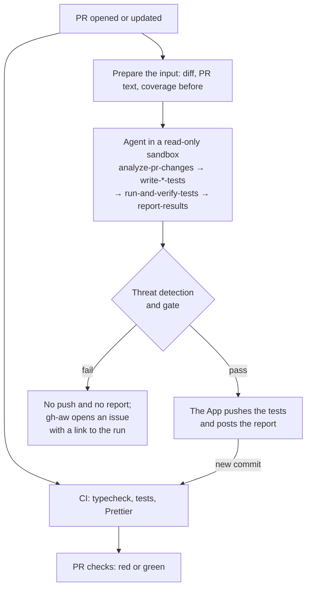

# Unit test agent for Taskly

An AI agent that writes unit tests for Taskly (React frontend, Express and Prisma backend). It runs on GitHub with [GitHub Agentic Workflows](https://github.github.com/gh-aw/) (gh-aw) and Claude.

On every pull request that changes code, the agent decides file by file whether tests are needed, writes them, runs them and posts a report. Its tests are checked independently before they are pushed. A second workflow, started by hand, opens a draft PR with tests for untested code.

**See it in action:** demo PR [#1] and coverage PR [#10].

## 1. Main technical decisions and rationale

| Decision | Rationale |
| --- | --- |
| **gh-aw with Claude** | gh-aw gives a read-only agent, declared write operations, a firewall and threat detection. Claude Code supports skills natively. `claude-sonnet-5-5` and gh-aw v1.2.2 are pinned. |
| **Checked before it is published** | A gate applies the agent's patch to a clean checkout. Only test files may change, nothing may be deleted, and tests, typecheck and Prettier must pass. |
| **No tests that accept bugs** | The agent tests intended behaviour. It changes an existing test only when the PR text states the new behaviour, and it reports suspected bugs. |
| **Plain CI next to the agent** | CI runs without AI and decides whether a PR can be merged. The agent only adds tests. |
| **Published as a GitHub App** | With the default `GITHUB_TOKEN`, CI on the agent's commits waits for approval. With the App, it runs automatically. |

**The agent only does the thinking.** The model is the expensive, non-deterministic part, and the part an attacker would target. So it gets only the work that needs judgment. Everything with one right answer is done by workflow steps and scripts, before or after it.

| Work | Done by | What it gains |
| --- | --- | --- |
| Fetch the diff, PR text, commits and changed files | Workflow step, before the agent | A fixed input; no model turns spent on API calls |
| Install dependencies, measure coverage before | Shared setup step | Install scripts disabled; no model turns |
| Sort the changed files and find their tests | `classify-changes.mjs` | Same answer every run |
| Rank untested files | `rank-coverage-gaps.mjs` | Same answer every run |
| Run tests, coverage, typecheck and Prettier, and print the tables | `verify-tests.mjs` | One command; the report's numbers are measured, not written by the model |
| Decide what changed and what to test, write the tests and the report | **Agent** | |
| Check the patch: test files only, nothing deleted, all checks pass | Gate | The agent cannot influence it |
| Push and comment | Publishing job, with the App's token | The agent never holds a write token |

**Cost**

- No run for PRs without code changes, none for the agent's own commits, and a new push cancels the run in progress.
- Skills load only when their step starts, so the prompt carries only the instructions in use. In the demo run, 89% of the tokens were read from cache.
- `claude-sonnet-5-5` instead of Opus. Limits on turns (60, or 120 for coverage), time (20 or 40 minutes) and coverage files, and a spend limit on the key.
- A PR run costs about $0.20–0.45. It takes about 7 minutes, of which the model works about 2; the rest is the isolated setup and the checks.

**Security**

- The PR's code is untrusted. The agent reads it in a read-only sandbox, behind a firewall, with allowlisted shell commands. Fork PRs are not processed.
- A separate job publishes, and only after the gate and threat detection (a second AI check for prompt injection, leaked secrets and malicious code) pass.
- The agent's instructions and skills come from the base branch, so a PR cannot change the agent that checks it.
- The Anthropic key is hidden from the agent. Actions and containers are pinned.

## 2. How to run the PR workflow and prerequisites

**Prerequisites**

- A repository secret `ANTHROPIC_API_KEY`, ideally with a spend limit.
- A GitHub App installed on this repository only: read and write for Contents, Issues and Pull requests, read for Actions and Checks. Client ID in the variable `TEST_AGENT_APP_ID`, private key in the secret `TEST_AGENT_APP_PRIVATE_KEY`.
- For the coverage workflow: "Allow GitHub Actions to create and approve pull requests".

**Running**

- **Pull requests**: open a PR that changes `backend/` or `frontend/`. The agent runs when the PR is opened and again on every push to the PR that changes code. Pushes to a branch without a PR do not start it. It comments in about 7 minutes.
- **Coverage** (optional, started by hand): Actions → Coverage agent → Run workflow. It ranks every file with untested code and writes tests for the top ones: 5 by default, or 3 or 8. Then it runs the whole test suite.

  **Why there is a limit.** Each file adds about $0.05 and several minutes. More files make a pull request that nobody can review properly, and a run that may hit the agent's step limit and publish nothing. The files further down the ranking are also worth less: often only a line or a branch is untested. To cover more, merge the pull request and run the workflow again; the next files are then at the top.

## 3. Where the custom agent and skills are defined and how they are used

| What | Where |
| --- | --- |
| Custom agent | `.github/agents/unit-test-engineer.md` |
| Skills | `.agents/skills/<name>/SKILL.md`, with scripts in `scripts/` |
| Workflows | `.github/workflows/unit-test-agent.md`, `coverage-agent.md`, `shared/install-and-measure.md` |
| Gate | `.github/scripts/verify-agent-patch.sh` |

Each workflow `.md` is compiled into the `.lock.yml` that GitHub runs (`gh aw compile`, gh-aw v1.2.2); both files are committed.

The coverage workflow starts with `find-coverage-gaps` and ends with a draft PR. The skills use the open [Agent Skills](https://agentskills.io/specification) format, so Copilot, Cursor, Codex and Gemini CLI read them from `.agents/skills/`. Claude Code can install them with `gh skill install`.

## 4. Example run: decisions, skills used and test results

Demo PR [#1] makes task titles unique: the API returns 409 and the form shows an error. Agent run: [demo run].

- **Decisions**: tests for the router, repository, `validateTodo`, `TodoForm` and `TodoEditor`. None for `TodosPage.tsx` (it only passes a prop), types and `openapi.json`. Three existing tests broke on the new method and prop. The PR states the change, so the agent fixed them and kept every expectation.
- **Skills used**: all five PR skills.
- **Results**: backend 79/79 and frontend 64/64 tests pass. Line coverage: backend 57% → 60%, frontend 68% → 73%, `TodoEditor.tsx` 46% → 92%.
- **Time and cost**: about 7 minutes and $0.45.

Coverage of `main` before this work and now: backend lines 33% → 58%, frontend 48% → 72%.

**Other runs**, each built to test one risk: a bug in the change ([#2]), a refactor without behaviour change ([#3]), a prompt injection in a code comment ([#4]), a behaviour change the PR does not state ([#5]), and removed code that still has tests ([#6]).

## 5. Assumptions

- Unit tests only: the database, network and time are mocked.
- People with write access are trusted, as in any CI.
- PR authors describe intended behaviour changes.

## 6. Limitations

- gh-aw is early-stage software; one needed feature exists only in pre-releases, so the gate replaces it.
- A PR uses the agent from its base branch, so agent changes apply after the branch is updated.
- On the agent's own commit, its run shows as *Skipped*: GitHub cannot filter triggers by who pushed, so gh-aw stops the run.
- Not tested: fork PRs, a real attack on threat detection, very large diffs.

## 7. What I would extend or change for production

- Run the agent when a PR is opened and then only on request (a label or a comment), not on every push to the PR.
- Keyless authentication over OIDC instead of a stored API key.
- Rulesets and CODEOWNERS for `main` and `.github/**`.
- An evaluation suite built from the test PRs, to catch regressions when prompts change.
- Mutation testing and property-based tests to measure test strength.

[#1]: https://github.com/veraokhrimenko/taskly-unit-test-agent/pull/1
[#2]: https://github.com/veraokhrimenko/taskly-unit-test-agent/pull/2
[#3]: https://github.com/veraokhrimenko/taskly-unit-test-agent/pull/3
[#4]: https://github.com/veraokhrimenko/taskly-unit-test-agent/pull/4
[#5]: https://github.com/veraokhrimenko/taskly-unit-test-agent/pull/5
[#6]: https://github.com/veraokhrimenko/taskly-unit-test-agent/pull/6
[#10]: https://github.com/veraokhrimenko/taskly-unit-test-agent/pull/10
[demo run]: https://github.com/veraokhrimenko/taskly-unit-test-agent/actions/runs/45778366652
