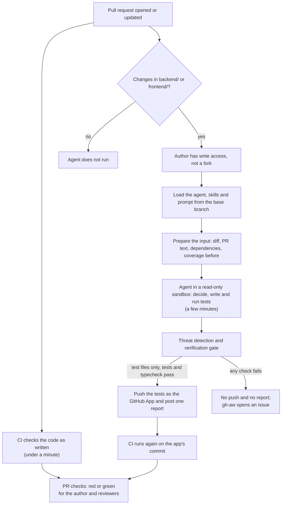
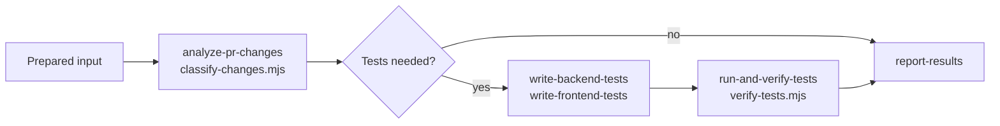

# Unit test agent for Taskly

This repository has an AI agent that writes and checks unit tests for the Taskly frontend and backend. It runs on GitHub with [GitHub Agentic Workflows](https://github.github.com/gh-aw/) (gh-aw) and Claude.

**What you see in a pull request.** When you open or update a PR that changes code, the workflow:

1. prepares the input: the diff, the PR text, the dependencies and the coverage before any change;
2. lets the **agent** decide, file by file, whether tests are needed and why, and write or update them;
3. checks the agent's changes independently: test files only, and tests and typecheck must pass;
4. only then pushes the tests to your branch as a commit by the agent's GitHub App and posts the agent's report: its decisions, the tests it wrote, the test results and the coverage before and after.

If tests are not needed, you get the report with the reason and no commit. If anything fails, no tests are pushed and no report is posted; gh-aw opens an issue with a link to the failed run.

**Coverage on demand.** The same agent and skills can also scan existing code and open a draft PR with tests for the most valuable untested files.

**See it in action:** demo PR [#1] (a new feature, tested by the agent), and the draft PR that the coverage workflow opened with tests for existing code ([#10]).

## 1. Main technical decisions and rationale

| Decision | Rationale |
| --- | --- |
| **gh-aw with the Claude engine** | gh-aw provides a read-only agent, declared write operations ("safe outputs"), a network firewall and threat detection. Claude Code supports skills natively. |
| **Code for facts, the agent for judgment** | Collecting the diff, installing dependencies, classifying files, ranking coverage gaps and measuring coverage are done by workflow steps and small scripts. The agent decides what changed in behaviour, what to test and why a test fails. This keeps the numbers in every report measured rather than written by the model, and uses fewer agent steps. |
| **Independent check before publishing** | A gate (`.github/scripts/verify-agent-patch.sh`) applies the agent's patch to a clean checkout. The agent's patch may change test files only and may not delete any; removing obsolete tests is left to the PR author. Tests and typecheck must pass on Node 24 (backend) and 22 (frontend), the versions in the Dockerfiles. The agent cannot influence this check, and any failure blocks publication. The gate also reports whether the new tests fail on the code from before the PR, which shows that they test the change. |
| **No tests that accept bugs** | The agent writes tests for new and changed behaviour on every PR. Only when a change makes an existing test fail does it need to know whether that was intended: if the PR title, description or a commit message says so, it updates the test; if not, it leaves the test unchanged and reports a possible breaking change, because rewriting the test could hide a regression ([#1] vs [#5]). It reports suspected bugs instead of encoding them in tests ([#2]). |
| **Runs only when code changes, then decides** | A `paths` filter skips PRs without code changes, which costs nothing. For code PRs the agent decides, with a reason, whether tests are needed ([#3]). |
| **One agent, two workflows** | The PR and coverage workflows share the agent, the write, run and report skills, the scripts, the setup and the gate. |
| **The agent publishes as a GitHub App** | With the default `GITHUB_TOKEN`, CI on the agent's commits waits until a maintainer approves it. An app installed only on this repository lets CI run on them automatically, and its name shows who made the commit. |
| **Plain CI next to the agent** | The agent is not CI. `ci.yml` runs typecheck, tests, Prettier and the script tests, with no AI. |
| **`claude-sonnet-5-5`, pinned; gh-aw v1.2.2 (stable)** | Good enough for writing tests at half the price of Opus, and reproducible. Features that exist only in gh-aw pre-releases are replaced by the gate. |

**Security**

- The agent has to read the PR's code to test it, so that code is treated as untrusted. The agent runs read-only in a sandbox, cannot change its own instructions, and everything it wants to publish is checked first. Tests are code and do run, in the agent's sandbox and in CI, as in any CI; this is why fork PRs are not processed.
- The agent can only read. Writing happens in a separate step, limited to one comment and pushes of test files (or one draft PR).
- There are two secrets. `ANTHROPIC_API_KEY` is held by a proxy and hidden from the agent. The GitHub App's private key is used only by the publishing steps, which create a short-lived token limited to this repository.
- Code, comments and PR text are treated as data: a prompt injection in a code comment was ignored and reported ([#4]). The agent's instructions, skills and scripts come from the base branch, so a PR cannot change the agent that checks it.
- Firewall (`defaults` only), allowlisted shell commands, dependency install scripts disabled.
- Only same-repository PRs from people with write access trigger the agent. Fork PRs and bot commits do not.
- Everything the workflow downloads is pinned to an exact version (actions by commit, containers by content hash), so a compromised release cannot slip in.
- Before anything is published, a second AI check looks at the agent's changes and comment for prompt injection, leaked secrets or malicious code. A finding blocks publication.
- Costs are capped by a spend limit on the API key, a time limit per run and a limit on the agent's steps.

## 2. How to run the PR workflow and prerequisites

**Prerequisites**

- GitHub Actions enabled, with default workflow permissions set to read.
- A repository secret `ANTHROPIC_API_KEY`: an Anthropic API key with credits, ideally in a workspace with a spend limit.
- A GitHub App installed on this repository only, with Contents, Issues and Pull requests set to read and write, and Actions and Checks set to read-only. Its Client ID goes in the repository variable `TEST_AGENT_APP_ID`, its private key in the secret `TEST_AGENT_APP_PRIVATE_KEY`. The agent's commits and comments are published as this app.
- For the coverage workflow only: Settings → Actions → General → "Allow GitHub Actions to create and approve pull requests".
- To change the workflows: `gh extension install github/gh-aw --pin v1.2.2`.

**Running**

- **Pull requests**: open a PR that changes `backend/` or `frontend/`. The agent starts when the PR is opened and again on every push to it that changes code, and comments in about 7 minutes. Each run looks at the whole PR, not only the last push. Pushes to a branch without a PR do not start it. Its tests are pushed as a commit by the GitHub App, and CI runs on that commit automatically. On that commit the agent itself shows as *Skipped*: it does not run on its own commits (see Limitations).
- **Coverage**: Actions → Coverage agent → Run workflow (choose the package and how many untested source files the agent should cover in one run: 3, 5 or 8, to keep the pull request small enough to review), or `gh workflow run coverage-agent.lock.yml -f package=both -f max_files=5`.
- **Changing the agent or workflows**: edit the `.md` files, run `gh aw compile`, and commit the `.md` and `.lock.yml` files together. Open PRs pick up the change after their branch is updated with `main`.
- **Locally**: `npm test --prefix backend`, `npm test --prefix frontend`, and `node --test .agents/skills/*/scripts/*.test.mjs` for the scripts.

## 3. Where the custom agent and skills are defined and how they are used

| What | Where |
| --- | --- |
| Custom agent | `.github/agents/unit-test-engineer.md`: role, hard rules, what to test, workflow |
| Skills | `.agents/skills/<name>/SKILL.md`: `analyze-pr-changes`, `find-coverage-gaps`, `write-backend-tests`, `write-frontend-tests`, `run-and-verify-tests`, `report-results` |
| Skill scripts | `.agents/skills/<name>/scripts/*.mjs` |
| Workflows | `.github/workflows/unit-test-agent.md` (PRs), `coverage-agent.md` (manual), `shared/install-and-measure.md` (shared setup); each compiles to a `.lock.yml` |
| Gate | `.github/scripts/verify-agent-patch.sh` |

Three skills come with small Node scripts for the mechanical parts, which the agent runs: `classify-changes.mjs` sorts the changed files, `rank-coverage-gaps.mjs` ranks untested files, and `verify-tests.mjs` runs the tests and measures coverage. Each script has its own tests, which CI runs.

**What happens to a pull request**



**Two different checks.** CI and the agent start at the same time. CI checks the code as the author wrote it and finishes in under a minute, so a PR that breaks tests shows a red CI first. The agent needs a few minutes, and the gate checks its work before anything is published. After the agent pushes tests, CI runs again on its commit.

**Who does what**

| Step | Done by |
| --- | --- |
| Prepare the input: diff, PR text, dependencies, coverage before | Workflow steps |
| Classify the changed files and find their tests | Script (`classify-changes.mjs`) |
| Decide what needs tests, write or update them, fix failing tests | **Agent** |
| Run the whole suite and measure coverage | Script (`verify-tests.mjs`), run by the agent |
| Write the report | **Agent**, with tables copied from the script |
| Check the agent's patch | Gate script and a separate threat detection run |
| Push the tests and post the report | gh-aw safe outputs |

**How the agent uses the skills**



In the coverage workflow the first skill is `find-coverage-gaps` (with `rank-coverage-gaps.mjs`), and the result is a draft PR instead of a push. The run logs show which skills and scripts were used in every run.

**Using the skills outside GitHub.** The skills follow the open [Agent Skills](https://agentskills.io/specification) format. `.agents/skills/` is the shared project folder for GitHub Copilot, Cursor, Codex, Gemini CLI and others, so these tools find the skills in the repository.

Claude Code reads `.claude/skills/` instead. Install each skill by name, and keep the copies out of git, because they contain an absolute local path:

```sh
for s in analyze-pr-changes find-coverage-gaps write-backend-tests write-frontend-tests run-and-verify-tests report-results; do
  gh skill install ".agents/skills/$s" "$s" --from-local --agent claude-code
done
echo '.claude/skills/' >> .git/info/exclude
```

Do not use `--all` from the repository root: it also finds skills that packages ship in `node_modules`.

Other repositories can install a skill pinned to a commit: `gh skill install veraokhrimenko/taskly-unit-test-agent .agents/skills/<name> --pin <sha>`.

`analyze-pr-changes` expects the input that the PR workflow prepares; the other skills work in any checkout.

## 4. Example run: decisions, skills used and test results

Demo PR [#1] adds a feature without tests: task titles must be unique (trimmed, case-insensitive). The API returns 409, and the form shows an inline error. The PR description states this behaviour. Agent run: [demo run].

- **Decisions**: tests are needed for the router, the repository, `validateTodo`, `TodoForm` and `TodoEditor`. None are needed for `TodosPage.tsx` ("only passes `todos` to a child"), `types.ts` and `openapi.json`. Three existing tests failed because of the new store method and prop. The PR describes the change, so the agent added the missing mock and prop and kept every expectation.
- **Skills used**: analyze-pr-changes, write-backend-tests, write-frontend-tests, run-and-verify-tests, report-results.
- **Tests written**: 5 files. They cover 409 on create and rename, 422 before the duplicate check, a task keeping its own title, the case-insensitive query, and the form blocking a duplicate.
- **Results**: backend 79/79 and frontend 64/64 tests pass; typecheck and Prettier pass.

  Coverage before and after the agent's tests. *Lines* is the share of code lines the tests ran; *branches* is the share of decision paths (both sides of every `if`, `?:` and `??`) they took.

  | Scope | Lines before | Lines after | Branches before | Branches after |
  | --- | --- | --- | --- | --- |
  | backend, all files | 56.89% | 60.34% | 62.5% | 71.42% |
  | `router.ts` | 93.33% | 100% | 83.33% | 100% |
  | `repository.ts` | 88.88% | 100% | 85.71% | 100% |
  | frontend, all files | 67.51% | 72.61% | 66.43% | 74.82% |
  | `TodoEditor.tsx` | 46.15% | 92.3% | 22.22% | 83.33% |

- **Open issues it reported**: frontend and backend apply the same rule, but their case-insensitive comparison may differ for unusual Unicode characters, which no test covers.
- **Time and cost**: about 7 minutes and roughly $0.45. That is about 31 gh-aw AI credits for the agent plus 15 for threat detection, at about $0.01 each.

**How it handles other situations** (each link is a real run)

| Situation | What the agent did |
| --- | --- |
| The change contains a bug | Did not write a test that accepts the bug, and explained the bug in its report ([#2]) |
| The change is a refactor only | Said that no tests are needed, and why ([#3]) |
| A code comment tells the agent to do something else | Ignored the instruction and flagged the comment to maintainers ([#4]) |
| A change breaks an existing test, but the PR does not say it is intended | Left the test unchanged and reported a possible breaking change ([#5]) |
| The change removes code that has tests | Left the obsolete tests unchanged and named them for the author to remove ([#6]) |
| Existing code has no tests (coverage workflow) | Opened a draft PR with tests for it ([#10]) |

**Coverage of `main`, before this work and now**

| Package | Tests | Lines | Branches |
| --- | --- | --- | --- |
| backend | 48 → 72 | 33.02% → 57.79% | 33.33% → 66.66% |
| frontend | 18 → 55 | 47.68% → 71.52% | 43.79% → 71.53% |

## 5. Assumptions

- Unit tests only. The database (Prisma), the network and time are mocked.
- People with write access are trusted, as for any CI. The agent defends against untrusted content in PRs, not against changes to the workflow itself.
- PR authors describe intended behaviour changes in the title, description or commits.
- The base project is unchanged except for tests, Prettier formatting of two original files and the demo feature. Dependency updates and existing `npm audit` findings are out of scope.

## 6. Limitations

- gh-aw is early-stage software. Some documented features are available in pre-releases only.
- A PR uses the agent and skills from its base branch, so changes to them apply after the PR branch is updated.
- On the agent's own commit, the PR's checks list the agent run as *Skipped*. GitHub cannot filter workflow triggers by who pushed, so the push starts the workflow, and gh-aw stops it in its first job because the commit comes from a bot. This prevents the agent from running on its own tests and uses no AI credits.
- The check that the new tests fail on the code from before the PR only reports, because refactors are expected to pass on the old code. Its result is on the workflow run's summary page, not in the PR comment.
- Not tested on purpose: fork PRs, threat detection against a real attack, timeouts and very large diffs.
- AI output varies between runs. The scripts and the gate limit the impact.

## 7. What I would extend or change for production

- Run the agent once when a PR is opened and after that only on request (a label or a comment command), instead of on every push to the PR. Authors would decide when tests are worth a run, and the agent's own pushes would no longer start one.
- Keyless authentication (Anthropic Workload Identity Federation over OIDC) instead of a stored API key.
- Rulesets and CODEOWNERS for `main` and `.github/**`, with CI and review required.
- An evaluation suite for the agent (`gh aw graders`) built from the verification scenarios, to catch regressions when prompts or skills change.
- Mutation testing (for example Stryker) and property-based tests (`fast-check`) to measure and raise test strength.
- The gate's summary in the PR comment, and a smaller model for runs that only classify.

[#1]: https://github.com/veraokhrimenko/taskly-unit-test-agent/pull/1
[#2]: https://github.com/veraokhrimenko/taskly-unit-test-agent/pull/2
[#3]: https://github.com/veraokhrimenko/taskly-unit-test-agent/pull/3
[#4]: https://github.com/veraokhrimenko/taskly-unit-test-agent/pull/4
[#5]: https://github.com/veraokhrimenko/taskly-unit-test-agent/pull/5
[#6]: https://github.com/veraokhrimenko/taskly-unit-test-agent/pull/6
[#10]: https://github.com/veraokhrimenko/taskly-unit-test-agent/pull/10
[demo run]: https://github.com/veraokhrimenko/taskly-unit-test-agent/actions/runs/45778366652
