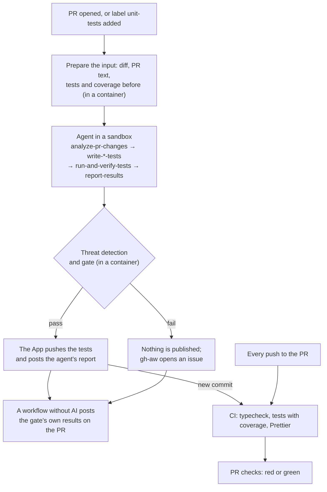

# Unit test agent for Taskly

An AI agent that writes unit tests for Taskly (React frontend, Express and Prisma backend). It runs on GitHub with [GitHub Agentic Workflows](https://github.github.com/gh-aw/) (gh-aw) and Claude.

When a pull request that changes code is opened, the agent decides file by file whether tests are needed, writes them, runs them and posts a report. Its tests are checked independently before they are pushed, and the workflow posts its own measured results next to the agent's report. A second workflow, started by hand, opens a draft PR with tests for untested code.

**See it in action:** demo PR [#31], with the agent's report and the workflow's independent check side by side, and coverage PR [#10].

## 1. Main technical decisions and rationale

| Decision | Rationale |
| --- | --- |
| **gh-aw with Claude** | gh-aw separates a sandboxed agent from the job that publishes, and adds a firewall and threat detection. Claude Code supports skills natively. `claude-sonnet-5-5` and gh-aw v1.2.2 are pinned. |
| **Checked before it is published** | A gate applies the agent's patch to a clean checkout and checks the tests themselves, not only the file paths (see below). The agent cannot influence it. |
| **No tests that accept bugs** | The agent tests intended behaviour. It changes an existing test only when the PR text states the new behaviour, and it reports suspected bugs. |
| **Runs once, then on request** | The agent runs when a PR is opened or leaves draft. After that it runs only when someone adds the label `unit-tests`. It does not push to the author's branch on every push, and each run is a decision, not a side effect. |
| **Plain CI next to the agent** | CI runs without AI and decides whether a PR can be merged. The agent only adds tests. |
| **Published as a GitHub App** | With the default `GITHUB_TOKEN`, CI on the agent's commits waits for approval. With the App, it runs automatically. |

**The agent only does the thinking.** The model is the expensive, non-deterministic part, and the part an attacker would target. So it gets only the work that needs judgment. Everything with one right answer is done by workflow steps and scripts, before or after it.

| Work | Done by | What it gains |
| --- | --- | --- |
| Fetch the diff, PR text, commits and changed files | Workflow step, before the agent | A fixed input; no model turns spent on API calls |
| Install dependencies, measure tests and coverage before | Gate script, in a container | Same environment as the final check; no model turns |
| Sort the changed files and find their tests | `classify-changes.mjs` | Same answer every run |
| Rank untested files | `rank-coverage-gaps.mjs` | Same answer every run |
| Run tests, coverage, typecheck and Prettier, and print the tables | `verify-tests.mjs` | One command for the agent |
| Decide what changed and what to test, write the tests and the report | **Agent** | |
| Check the patch and measure again | Gate | The agent cannot influence it |
| Push and comment | Publishing job, with the App's token | The agent never holds a write token |
| Post the gate's own numbers on the PR | A workflow without AI | The reader can compare them with the agent's report |

**What the gate checks.** Only test files may change (`*.test.ts`, `*.test.tsx`); fixtures and helpers may not. No file is deleted, no existing test disappears or is renamed, no `.skip`, `.only` or `.todo` is added, and an existing test file does not lose assertions. Tests, coverage thresholds, typecheck and Prettier must pass. It also reports, for each new test, how it behaves on the code from before the PR: it fails on an assertion (it detects the change), it cannot run (it needs new code), or it also passes.

**Cost**

- No run for PRs that change nothing under `backend/` or `frontend/`, none for draft PRs, and none for pushes.
- Skills load only when their step starts, so the prompt carries only the instructions in use. In the first demo run ([#1]), 89% of the tokens were read from cache.
- `claude-sonnet-5-5` instead of Opus. Limits on turns (60, or 120 for coverage), time (20 or 40 minutes) and coverage files, and a spend limit on the key.
- A PR run costs about $0.20–0.45 and takes 7 to 8 minutes. The model works for about 2 of them; the rest is the isolated setup and the checks.

**Security**

- Code from the PR, and tests written by the agent, never run on the runner itself. The agent works in a sandbox behind a firewall, where it can edit its checkout and run a short list of commands, and it has no write access to GitHub. The baseline and the gate run in containers that see only the checkout and have no network once dependencies are installed. In them `.git` is read-only, so a test cannot plant a Git setting that would run on the runner later, and they can write results only to a folder of their own, not to the gate's summary.
- A separate job publishes, and only after the gate and threat detection (a second AI check for prompt injection, leaked secrets and malicious code) pass.
- The agent's prompt, skills and scripts come from the base branch. The workflow file itself comes from the PR, as for every GitHub workflow, so people with write access are trusted, and CODEOWNERS covers `.github/` and `.agents/`. Fork PRs are not processed.
- The Anthropic key is hidden from the agent, and the agent has no GitHub access: gh-aw's default GitHub server is turned off, because the agent never used it and it could read comments that anyone can write. Actions and containers are pinned.

**What an external review changed.** I asked for a review of this solution and fixed what it found. Before it, the PR's tests ran on the runner in a job that also holds the API key, and the gate only compared file paths, so an agent could have skipped or removed a test. The check "do the new tests detect the change?" counted an import error as success. A coverage threshold in the project could block the agent in the exact case it exists for. All of this is fixed and was verified on [#24] and [#31].

## 2. How to run the PR workflow and prerequisites

**Prerequisites**

- A repository secret `ANTHROPIC_API_KEY`, ideally with a spend limit.
- A GitHub App installed on this repository only: read and write for Contents, Issues and Pull requests, read for Actions and Checks. Client ID in the variable `TEST_AGENT_APP_ID`, private key in the secret `TEST_AGENT_APP_PRIVATE_KEY`.
- A label named `unit-tests`.
- For the coverage workflow: "Allow GitHub Actions to create and approve pull requests".

**Running**

- **Pull requests**: open a PR that changes `backend/` or `frontend/`. The agent runs once and comments in 7 to 8 minutes. To run it again after more changes, add the label `unit-tests` (remove it first if it is already there). Pushes do not start the agent; CI runs on every push.
- **Coverage** (optional, started by hand): Actions → Coverage agent → Run workflow. It ranks every file with untested code and writes tests for the top ones: 5 by default, or 3 or 8. Then it runs the whole test suite.

  **Why there is a limit.** Each file adds about $0.05 and several minutes. More files make a pull request that nobody can review properly, and a run that may hit the agent's step limit and publish nothing. The files further down the ranking are also worth less: often only a line or a branch is untested. To cover more, merge the pull request and run the workflow again; the next files are then at the top.

## 3. Where the custom agent and skills are defined and how they are used

| What | Where |
| --- | --- |
| Custom agent | `.github/agents/unit-test-engineer.md` |
| Skills | `.agents/skills/<name>/SKILL.md`, with scripts in `scripts/` |
| Workflows | `.github/workflows/unit-test-agent.md`, `coverage-agent.md`, and the shared parts in `shared/agent-common.md` and `shared/install-and-measure.md` |
| Gate | `.github/scripts/verify-agent-patch.sh` and `gate-report.mjs` |
| Independent comment | `.github/workflows/agent-check-comment.yml` |

Each workflow `.md` is compiled into the `.lock.yml` that GitHub runs (`gh aw compile`, gh-aw v1.2.2); both files are committed.

The coverage workflow starts with `find-coverage-gaps` and ends with a draft PR. The skills use the open [Agent Skills](https://agentskills.io/specification) format. `write-backend-tests` and `write-frontend-tests` work in any agent that reads `.agents/skills/` (Copilot, Cursor, Codex, Gemini CLI) or after `gh skill install` (Claude Code). The other skills expect the input files that these workflows prepare.

## 4. Example run: decisions, skills used and test results

Demo PR [#31] adds a feature without tests: task titles must be unique, the API returns 409 and the form shows an error. Agent run: [demo run]. It is the current pipeline from start to finish.

- **Before the agent**: CI failed on the feature commit, because existing tests did not know the new store method and the new prop.
- **Decisions**: tests for the router, repository, `validateTodo`, `TodoForm` and `TodoEditor`. None for `TodosPage.tsx` (it only passes a prop), types and `openapi.json`. The broken router and `TodoEditor` tests were updated, because the PR states the change; every expectation was kept.
- **Skills used**: all five PR skills.
- **Results, measured again by the gate**: backend 81/81 and frontend 64/64 tests pass, no existing test removed, typecheck and Prettier pass. Line coverage: backend 57% → 60%, frontend 68% → 73%, `TodoEditor.tsx` 46% → 92%.
- **Do the new tests detect the change?** Of 18 new tests, 9 fail on an assertion on the code from before the PR, 4 need code that the PR adds, and 5 also pass. Those 5 check what the change must not break, for example that a unique title is still submitted.
- **After the agent**: the App pushed one commit with the tests, CI ran on it automatically and passed, and the agent did not start again.
- **Reported, not fixed**: the frontend and the database may compare some non-ASCII titles differently, and the form's handling of the server's 409 has no test. In its report the agent also says that it did not read the frontend failure log, which the skill asks for.
- **Time**: 8 minutes, of which the agent job (setup, baseline and the model) took 3.5. Token use was close to the first run of this feature ([#1], with the earlier pipeline), which cost about $0.45.

PR [#24] was the first run of the hardened pipeline. The agent wrote 13 tests for three small changes, and the gate measured them again: backend 82/82, frontend 58/58, no existing test removed. Of the 10 new backend tests, 2 fail on an assertion on the old code, 7 need code that the PR adds, and 1 also passes. One of the changes was below a 100% coverage threshold; the agent's tests brought it back above.

Coverage of `main` before this work and now: backend lines 33% → 58%, frontend 48% → 72%. Coverage is a by-product here: the agent is told to test behaviour that can break, not to raise a number.

**Other runs**, each built to test one risk: a bug in the change ([#2]), a refactor without behaviour change ([#3]), a prompt injection in a code comment ([#4]), a behaviour change the PR does not state ([#5]), and removed code that still has tests ([#6]).

## 5. Assumptions

- Unit tests only: the database, network and time are mocked.
- People with write access are trusted, as in any CI: they can change the workflow itself.
- PR authors describe intended behaviour changes.

## 6. Limitations

- When a PR removes code, tests for that code are obsolete. The agent names them and the author removes them; the agent's own new tests are shown in its report but not pushed while the suite is red.
- The gate notices removed tests and removed assertions, but not an assertion rewritten to check less.
- A PR uses the workflow and the agent as they were when its branch was last updated with `main`.
- Each scenario was run a few times, not enough to measure how much the results vary. The injection test is one obvious comment, not a determined attack.
- The scripts map a source file to its test by file name, and the coverage ranking knows Taskly's folders. Another project would need to adjust both.
- gh-aw is early-stage software; one needed feature exists only in pre-releases, so the gate replaces it.
- Not tested: fork PRs, a real attack on threat detection, very large diffs.

## 7. What I would extend or change for production

- An evaluation suite built from the test PRs and run many times, to measure variance and catch regressions when prompts change.
- Let the agent delete an obsolete test when code can prove that it only covers removed code.
- Mutation testing and property-based tests, to measure test strength instead of coverage.
- Keyless authentication over OIDC instead of a stored API key.
- A ruleset that requires an owner's review for `.github/**` and `.agents/**`.
- More context about intent, such as linked issues and review comments from people with write access, prepared as input like the PR text.

[#1]: https://github.com/veraokhrimenko/taskly-unit-test-agent/pull/1
[#2]: https://github.com/veraokhrimenko/taskly-unit-test-agent/pull/2
[#3]: https://github.com/veraokhrimenko/taskly-unit-test-agent/pull/3
[#4]: https://github.com/veraokhrimenko/taskly-unit-test-agent/pull/4
[#5]: https://github.com/veraokhrimenko/taskly-unit-test-agent/pull/5
[#6]: https://github.com/veraokhrimenko/taskly-unit-test-agent/pull/6
[#10]: https://github.com/veraokhrimenko/taskly-unit-test-agent/pull/10
[#24]: https://github.com/veraokhrimenko/taskly-unit-test-agent/pull/24
[#31]: https://github.com/veraokhrimenko/taskly-unit-test-agent/pull/31
[demo run]: https://github.com/veraokhrimenko/taskly-unit-test-agent/actions/runs/45818745058
