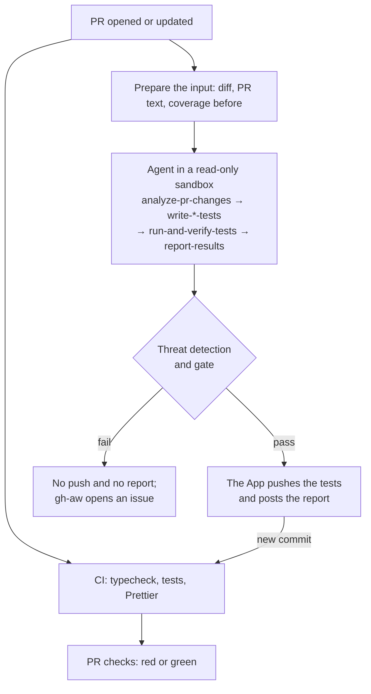

# Unit test agent for Taskly

This repository adds an AI agent to Taskly (React frontend, Express and Prisma backend) that writes unit tests. It runs on GitHub with [GitHub Agentic Workflows](https://github.github.com/gh-aw/) (gh-aw) and Claude.

On every pull request that changes code, the agent decides file by file whether tests are needed, writes or updates them, runs them and posts a report. Its tests are checked independently before they are pushed. A second workflow, started by hand, opens a draft PR with tests for the most valuable untested files.

**See it in action:** demo PR [#1] and coverage PR [#10].

## 1. Main technical decisions and rationale

| Decision | Rationale |
| --- | --- |
| **gh-aw with Claude** | gh-aw provides a read-only agent, declared write operations, a firewall and threat detection. Claude Code supports skills natively. `claude-sonnet-5-5` writes good tests at a lower price than Opus. The model and gh-aw v1.2.2 (stable) are pinned. |
| **Code for facts, the agent for judgment** | Scripts collect the diff, classify files, rank coverage gaps and measure coverage. The agent decides what to test and why a test fails. Every number in a report is measured, not written by the model. |
| **Checked before it is published** | A gate applies the agent's patch to a clean checkout. Only test files may change, none may be deleted, and tests and typecheck must pass. The gate also reports whether the new tests fail on the code from before the PR, which shows that they test the change. |
| **No tests that accept bugs** | The agent tests intended behaviour. It changes an existing test only when the PR text states the new behaviour, and it reports suspected bugs instead of encoding them in tests. |
| **One agent, two workflows, plus plain CI** | The PR and coverage workflows share the agent, skills, scripts and gate. CI runs without AI and decides whether a PR can be merged. The agent only adds tests. |
| **Published as a GitHub App** | With the default `GITHUB_TOKEN`, CI on the agent's commits waits for a maintainer's approval. With an app limited to this repository, it runs automatically. |

**Security**

- The agent has to read the PR's code, so that code is untrusted. The agent runs read-only in a sandbox, behind a firewall (`defaults` only), with allowlisted shell commands and without dependency install scripts.
- Only PRs from people with write access start the agent. Fork PRs do not, because tests are code and they run.
- A separate job publishes: one comment and pushes of test files, or one draft PR. It runs only after the gate and threat detection pass. Threat detection is a second AI check for prompt injection, leaked secrets and malicious code.
- PR content is treated as data. The agent's instructions, skills and scripts come from the base branch, so a PR cannot change the agent that checks it.
- A proxy hides the Anthropic key from the agent. Only the publishing job uses the App's key. Actions and containers are pinned to exact versions. A spend limit, a time limit and a step limit cap the cost.

## 2. How to run the PR workflow and prerequisites

**Prerequisites**

- A repository secret `ANTHROPIC_API_KEY`, ideally from a workspace with a spend limit.
- A GitHub App installed on this repository only, with read and write access to Contents, Issues and Pull requests, and read access to Actions and Checks. Its Client ID goes in the variable `TEST_AGENT_APP_ID`, its private key in the secret `TEST_AGENT_APP_PRIVATE_KEY`.
- Default workflow permissions set to read. For the coverage workflow, also "Allow GitHub Actions to create and approve pull requests".
- To change the workflows: `gh extension install github/gh-aw --pin v1.2.2`.

**Running**

- **Pull requests**: open a PR that changes `backend/` or `frontend/`. The agent runs when the PR is opened and on every push that changes code, each time on the whole PR. It comments in about 7 minutes. Its tests arrive as a commit by the App, and CI runs on it automatically.
- **Coverage**: Actions → Coverage agent → Run workflow. Choose the package and how many untested source files to cover: 3, 5 or 8, so the PR stays small enough to review. Or: `gh workflow run coverage-agent.lock.yml -f package=both -f max_files=5`.
- **Changing the agent**: edit the `.md` files, run `gh aw compile`, and commit the `.md` and `.lock.yml` files together.
- **Locally**: `npm test --prefix backend`, `npm test --prefix frontend`, and `node --test .agents/skills/*/scripts/*.test.mjs`.

## 3. Where the custom agent and skills are defined and how they are used

| What | Where |
| --- | --- |
| Custom agent | `.github/agents/unit-test-engineer.md`: role, hard rules, what to test, workflow |
| Skills | `.agents/skills/<name>/SKILL.md`: `analyze-pr-changes`, `find-coverage-gaps`, `write-backend-tests`, `write-frontend-tests`, `run-and-verify-tests`, `report-results` |
| Skill scripts | `.agents/skills/<name>/scripts/*.mjs`, with tests that CI runs |
| Workflows | `.github/workflows/unit-test-agent.md` (PRs), `coverage-agent.md` (manual), `shared/install-and-measure.md` (shared setup) |
| Gate | `.github/scripts/verify-agent-patch.sh` |



When no tests are needed, the agent goes straight to `report-results`. The coverage workflow starts with `find-coverage-gaps` and ends with a draft PR. Scripts do the mechanical parts: `classify-changes.mjs` sorts the changed files, `rank-coverage-gaps.mjs` ranks untested files, and `verify-tests.mjs` runs the tests and measures coverage.

**Using the skills elsewhere.** The skills use the open [Agent Skills](https://agentskills.io/specification) format, which GitHub Copilot, Cursor, Codex and Gemini CLI read from `.agents/skills/`. Claude Code reads `.claude/skills/`. Install the skills there by name, because `--all` also picks up skills from `node_modules`, and keep the copies out of git:

```sh
for s in analyze-pr-changes find-coverage-gaps write-backend-tests write-frontend-tests run-and-verify-tests report-results; do
  gh skill install ".agents/skills/$s" "$s" --from-local --agent claude-code
done
echo '.claude/skills/' >> .git/info/exclude
```

## 4. Example run: decisions, skills used and test results

Demo PR [#1] adds a feature without tests: task titles must be unique, ignoring case and surrounding spaces. The API returns 409, and the form shows an error. The PR description states this behaviour. Agent run: [demo run].

- **Decisions**: tests are needed for the router, the repository, `validateTodo`, `TodoForm` and `TodoEditor`. None are needed for `TodosPage.tsx` (it only passes a prop), `types.ts` and `openapi.json`. Three existing tests broke because of the new store method and prop. The PR states the change, so the agent fixed the mock and the prop and kept every expectation.
- **Skills used**: analyze-pr-changes, write-backend-tests, write-frontend-tests, run-and-verify-tests, report-results.
- **Tests written**: 5 files, covering 409 on create and rename, 422 before the duplicate check, a task keeping its own title, the case-insensitive query, and the form blocking a duplicate.
- **Results**: backend 79/79 and frontend 64/64 tests pass, and so do typecheck and Prettier. *Lines* is the share of code lines the tests ran, *branches* the share of decision paths they took.

  | Scope | Lines before → after | Branches before → after |
  | --- | --- | --- |
  | backend | 56.89% → 60.34% | 62.5% → 71.42% |
  | frontend | 67.51% → 72.61% | 66.43% → 74.82% |
  | `TodoEditor.tsx` | 46.15% → 92.3% | 22.22% → 83.33% |

- **Open issue reported**: the frontend and backend may compare unusual Unicode characters differently.
- **Time and cost**: about 7 minutes and $0.45.

**Coverage of `main`, before this work and now:** backend 48 → 72 tests, lines 33% → 58%, branches 33% → 67%. Frontend 18 → 55 tests, lines 48% → 72%, branches 44% → 72%.

### How I tested the agent and what that changed

I opened PRs that each target one way the agent could go wrong. When a run exposed a weakness, I fixed it and ran the scenario again. The links show runs of the final version.

| Risk | Test PR | What happened, and what changed |
| --- | --- | --- |
| Tests that accept a bug | The change drops `return router;` ([#2]) | The agent found the bug and wrote no tests for it. Early runs marked this as a failure. Now a suspected bug is a normal result. |
| A test rewritten to hide a regression | A title limit lowered from 120 to 100, not stated in the PR ([#5]) | From the diff alone, the agent first updated the old test. Now it reads the PR text and changes a test only when the new behaviour is stated. Otherwise it reports a possible breaking change. |
| A rule changed in one package only | The same PR ([#5]) | The frontend still allowed 120 characters. The agent now compares validation rules and API contracts across packages. |
| Tests for removed code | A function and its use removed ([#6]) | Deleting the obsolete tests would fail the gate and block the report. Now the agent names them for the author instead. |
| Prompt injection | A code comment telling the agent to delete tests ([#4]) | Ignored and flagged. |
| Tests nobody needs | A rename-only refactor ([#3]) | No tests, with a reason. |
| Results that were not measured | Run logs, which list the skills and commands used | The agent sometimes skipped a skill and left coverage unmeasured. Now scripts measure, and the agent copies their tables. |
| Giving up too early | A coverage run | After one denied command, the agent stopped using the shell. Its rules now list the allowed commands. |

The test PR descriptions never state the expected result, because the agent reads them.

## 5. Assumptions

- Unit tests only. The database, the network and time are mocked.
- People with write access are trusted, as in any CI. The agent defends against untrusted content in PRs, not against changes to the workflow itself.
- PR authors describe intended behaviour changes in the title, description or commits.
- The base project is unchanged except for tests, Prettier formatting of two files and the demo feature.

## 6. Limitations

- gh-aw is early-stage software. One feature this needed exists only in pre-releases, so the gate replaces it.
- A PR uses the agent and skills from its base branch, so changes to them apply only after the PR branch is updated.
- On the agent's own commit, the agent run shows as *Skipped*. GitHub cannot filter triggers by who pushed, so gh-aw stops the run in its first job, at no AI cost.
- The check that new tests fail on the old code only reports, because refactors pass on the old code too. Its result is on the run's summary page.
- Not tested: fork PRs, a real attack on threat detection, timeouts and very large diffs. AI output varies between runs; the scripts and the gate limit the impact.

## 7. What I would extend or change for production

- Run the agent when a PR is opened and after that only on request, with a label or a comment command, instead of on every push.
- Keyless authentication (Anthropic Workload Identity Federation over OIDC) instead of a stored API key.
- Rulesets and CODEOWNERS for `main` and `.github/**`, with CI and review required.
- An evaluation suite (`gh aw graders`) built from the test PRs, to catch regressions when prompts or skills change.
- Mutation testing (Stryker) and property-based tests (`fast-check`) to measure and raise test strength.
- The gate's summary in the PR comment, and a smaller model for runs that only classify.

[#1]: https://github.com/veraokhrimenko/taskly-unit-test-agent/pull/1
[#2]: https://github.com/veraokhrimenko/taskly-unit-test-agent/pull/2
[#3]: https://github.com/veraokhrimenko/taskly-unit-test-agent/pull/3
[#4]: https://github.com/veraokhrimenko/taskly-unit-test-agent/pull/4
[#5]: https://github.com/veraokhrimenko/taskly-unit-test-agent/pull/5
[#6]: https://github.com/veraokhrimenko/taskly-unit-test-agent/pull/6
[#10]: https://github.com/veraokhrimenko/taskly-unit-test-agent/pull/10
[demo run]: https://github.com/veraokhrimenko/taskly-unit-test-agent/actions/runs/45778366652
