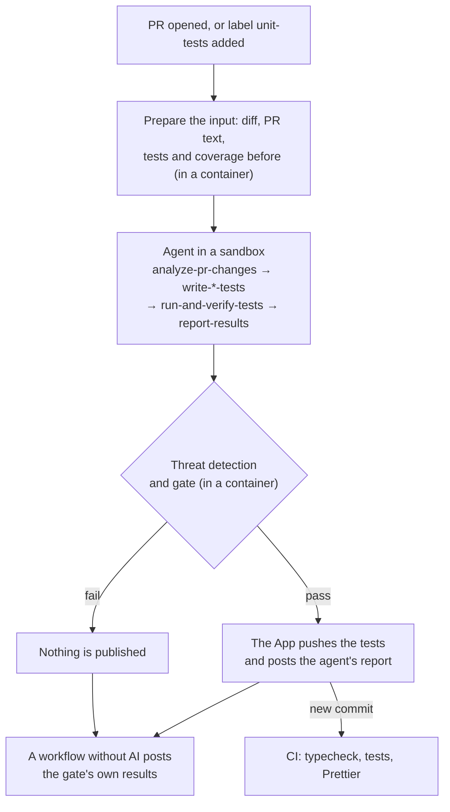

# Unit test agent for Taskly

An AI agent that writes unit tests for Taskly (React frontend, Express and Prisma backend). It runs on GitHub with [GitHub Agentic Workflows](https://github.github.com/gh-aw/) (gh-aw) and Claude.

When a pull request that changes code is opened, the agent decides file by file whether tests are needed, writes them, runs them and posts a report. A gate checks its tests before they are pushed, and a workflow without AI posts the gate's own numbers next to the agent's report. A second workflow, started by hand, opens a draft PR with tests for untested code.

**See the result in one minute:** demo PR [#31], with the [independent check] and the [agent's report].

## 1. Main technical decisions and rationale

| Decision | Rationale |
| --- | --- |
| **gh-aw with Claude** | gh-aw separates a sandboxed agent from the job that publishes, and adds a firewall and threat detection. Claude Code supports skills natively. `claude-sonnet-5-5` and gh-aw v1.2.2 are pinned. |
| **The agent only does the thinking** | The model is the expensive, non-deterministic part, and the one an attacker would target. Workflow steps and scripts do everything with one right answer: fetch the diff, measure tests and coverage before, map files to their tests, run the checks, push and comment. The agent decides what to test and writes the tests and the report. |
| **Checked before it is published** | A gate applies the agent's patch to a clean checkout. Only test files may change. No test may be deleted, renamed, skipped or lose assertions. Tests, coverage thresholds, typecheck and Prettier must pass. It also reports how each new test behaves on the code from before the PR. |
| **No tests that accept bugs** | The agent tests intended behaviour. It changes an existing test only when the PR text states the new behaviour, and it reports suspected bugs. |
| **Runs once, then on request** | The agent runs when a PR is opened or leaves draft, and again only when someone adds the label `unit-tests`. It does not push to the author's branch on every push. |
| **Plain CI next to the agent** | CI runs without AI on every PR, and its three jobs are required checks on `main`. The agent only adds tests. |
| **Published as a GitHub App** | With the default `GITHUB_TOKEN`, CI on the agent's commits waits for approval. With the App, it runs automatically. |

**Security**

- The agent works in a sandbox behind a firewall, without the Anthropic key and without GitHub access. A separate job publishes with the App's token, and only after the gate and threat detection (a second AI check for prompt injection, leaked secrets and malicious code) pass.
- The agent workflow runs the baseline and the gate's tests in containers without network, with `.git` read-only and one output folder of their own. Dependency installation and backend client generation use network access; the containers hold no secrets. Standard CI runs separately on GitHub-hosted runners, in jobs without secrets.
- The agent's prompt, skills and scripts come from the base branch. The workflow and the gate script come from the PR, so the agent cannot change the gate, but a PR author can: people with write access are trusted. A ruleset on `main` requires a pull request, passing CI and the owner's review for `.github/` and `.agents/`. The owner can bypass it, because there is no second reviewer. Fork PRs are not processed. Actions and containers are pinned.

**Cost.** A PR run costs about $0.20–0.45 and takes 7 to 8 minutes. There is no run for drafts, for pushes, or for PRs that change nothing under `backend/` or `frontend/`. The model is `claude-sonnet-5-5`, with limits on turns and time and a spend limit on the key.

## 2. How to run the PR workflow and prerequisites

**Prerequisites**

- A repository secret `ANTHROPIC_API_KEY`, ideally with a spend limit.
- A GitHub App installed on this repository only: read and write for Contents, Issues and Pull requests, read for Actions and Checks. Client ID in the variable `TEST_AGENT_APP_ID`, private key in the secret `TEST_AGENT_APP_PRIVATE_KEY`.
- A label named `unit-tests`.
- For the coverage workflow: "Allow GitHub Actions to create and approve pull requests".

**Running**

- **Pull requests**: open a PR that changes `backend/` or `frontend/`. The agent runs once and comments in 7 to 8 minutes. To run it again after more changes, add the label `unit-tests` (remove it first if it is already there).
- **Coverage** (optional): Actions → Coverage agent → Run workflow. It ranks the files with untested code and writes tests for the top 3, 5 or 8, then opens a draft PR. The limit keeps the PR reviewable; to cover more, merge it and run again.

## 3. Where the custom agent and skills are defined and how they are used

| What | Where |
| --- | --- |
| Custom agent | `.github/agents/unit-test-engineer.md` |
| Skills | `.agents/skills/<name>/SKILL.md`, with scripts in `scripts/` |
| Workflows | `.github/workflows/unit-test-agent.md`, `coverage-agent.md`, and the shared parts in `shared/` |
| Gate | `.github/scripts/verify-agent-patch.sh` and `gate-report.mjs` |
| Independent comment | `.github/workflows/agent-check-comment.yml` |

The workflow imports the agent and lists its skills; the agent loads each skill with the Skill tool when its step starts. The coverage workflow starts with `find-coverage-gaps` instead of `analyze-pr-changes`. Each workflow `.md` is compiled into the `.lock.yml` that GitHub runs (`gh aw compile`); both are committed. The skills use the open [Agent Skills](https://agentskills.io/specification) format.

## 4. Example run: decisions, skills used and test results

Demo PR [#31] adds a feature without tests: task titles must be unique, the API returns 409 and the form shows an error. Run: [demo run].

- **Decisions**: tests for the router, repository, `validateTodo`, `TodoForm` and `TodoEditor`. None for `TodosPage.tsx` (it only passes a prop), types and `openapi.json`. CI was red on the feature commit, because existing tests did not know the new method and prop. The PR states the change, so the agent updated them and kept every expectation.
- **Skills used**: `analyze-pr-changes`, `write-backend-tests`, `write-frontend-tests`, `run-and-verify-tests`, `report-results`.
- **Results, measured by the gate**: backend 81/81 and frontend 64/64 tests pass, no existing test removed, typecheck and Prettier pass. Line coverage: backend 57% → 60%, frontend 68% → 73%.
- **Do the new tests detect the change?** Of 18 new tests, 9 fail on an assertion on the old code, 4 need code that the PR adds, and 5 also pass.
- **After the agent**: the App pushed one commit, CI passed on it, and the agent did not start again. 8 minutes in total.

Other runs, each built to test one risk: a bug in the change ([#37]), a refactor ([#38]), a prompt injection in a code comment ([#39]), a behaviour change the PR does not state ([#40]), removed code that still has tests ([#41]), and a coverage run ([#42]). Coverage of `main` before this work and now: backend lines 33% → 58%, frontend 48% → 72%.

## 5. Assumptions

- Unit tests only: the database, network and time are mocked.
- People with write access are trusted, as in any CI: they can change the workflow itself.
- PR authors describe intended behaviour changes.

## 6. Limitations

- The gate notices removed tests and removed assertions, but not an assertion rewritten to check less.
- A test runs in the same process that writes the report the gate reads, so a malicious test could forge the counts. The containers limit what such a test can reach, not what it reports.
- When a PR removes code, the agent names the obsolete tests and the author removes them. The agent's new tests are not pushed while the suite is red.
- A PR uses the workflow as it was when its branch was last updated with `main`.
- Each scenario was run a few times, not enough to measure variance. The injection test is one obvious comment, not a determined attack.
- The scripts map a source file to its test by file name and know Taskly's folders.
- Not tested: fork PRs, a real attack on threat detection, very large diffs.

## 7. What I would extend or change for production

- An evaluation suite built from the test PRs and run many times, to measure variance and catch regressions when prompts change.
- Mutation testing, to measure test strength instead of coverage.
- The gate script taken from the base branch, Prisma's engine cached so that no project code runs with network access, and a second maintainer, so that the owner's review needs no bypass.
- Keyless authentication over OIDC instead of a stored API key.
- Let the agent delete an obsolete test when code can prove that it only covers removed code.

[#37]: https://github.com/veraokhrimenko/taskly-unit-test-agent/pull/37
[#38]: https://github.com/veraokhrimenko/taskly-unit-test-agent/pull/38
[#39]: https://github.com/veraokhrimenko/taskly-unit-test-agent/pull/39
[#40]: https://github.com/veraokhrimenko/taskly-unit-test-agent/pull/40
[#41]: https://github.com/veraokhrimenko/taskly-unit-test-agent/pull/41
[#42]: https://github.com/veraokhrimenko/taskly-unit-test-agent/pull/42
[#31]: https://github.com/veraokhrimenko/taskly-unit-test-agent/pull/31
[independent check]: https://github.com/veraokhrimenko/taskly-unit-test-agent/pull/31#issuecomment-7192057815
[agent's report]: https://github.com/veraokhrimenko/taskly-unit-test-agent/pull/31#issuecomment-7192041120
[demo run]: https://github.com/veraokhrimenko/taskly-unit-test-agent/actions/runs/45818745058
