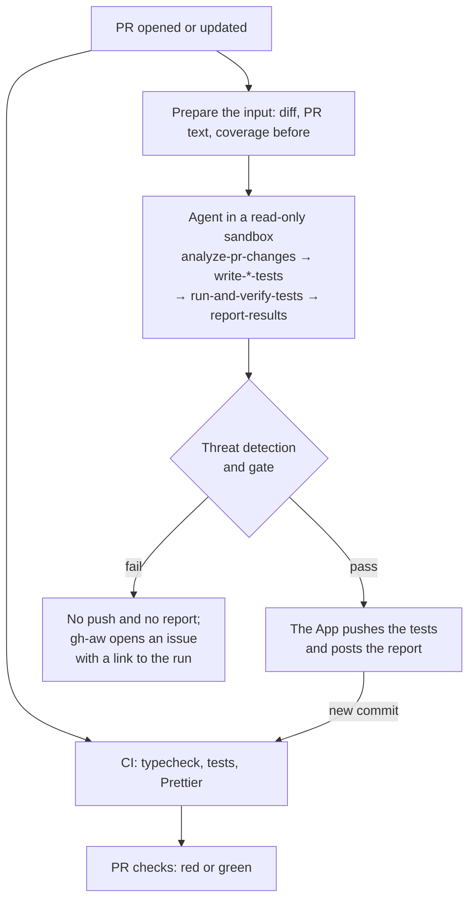

# Unit test agent for Taskly

An AI agent that writes unit tests for Taskly (React frontend, Express and Prisma backend). It runs on GitHub with [GitHub Agentic Workflows](https://github.github.com/gh-aw/) (gh-aw) and Claude.

On every pull request that changes code, the agent decides file by file whether tests are needed, writes them, runs them and posts a report. Its tests are checked independently before they are pushed. A second workflow, started by hand, opens a draft PR with tests for untested code.

**See it in action:** demo PR [#1] and coverage PR [#10].

## 1. Main technical decisions and rationale

| Decision | Rationale |
| --- | --- |
| **gh-aw with Claude** | gh-aw gives a read-only agent, declared write operations, a firewall and threat detection. Claude Code supports skills natively. `claude-sonnet-5-5` and gh-aw v1.2.2 are pinned. |
| **Code for facts, the agent for judgment** | Scripts classify files, rank coverage gaps and measure coverage. The agent decides what to test and why a test fails. Report numbers are measured, not written by the model. |
| **Checked before it is published** | A gate applies the agent's patch to a clean checkout. Only test files may change, nothing may be deleted, and tests and typecheck must pass. |
| **No tests that accept bugs** | The agent tests intended behaviour. It changes an existing test only when the PR text states the new behaviour, and it reports suspected bugs. |
| **Plain CI next to the agent** | CI runs without AI and decides whether a PR can be merged. The agent only adds tests. |
| **Published as a GitHub App** | With the default `GITHUB_TOKEN`, CI on the agent's commits waits for approval. With the App, it runs automatically. |

**Security**

- The PR's code is untrusted. The agent reads it in a read-only sandbox, behind a firewall, with allowlisted shell commands. Fork PRs are not processed.
- A separate job publishes, and only after the gate and threat detection (a second AI check for prompt injection, leaked secrets and malicious code) pass.
- The agent's instructions and skills come from the base branch, so a PR cannot change the agent that checks it.
- The Anthropic key is hidden from the agent. Actions and containers are pinned. Spend, time and step limits cap the cost.

## 2. How to run the PR workflow and prerequisites

**Prerequisites**

- A repository secret `ANTHROPIC_API_KEY`, ideally with a spend limit.
- A GitHub App installed on this repository only: read and write for Contents, Issues and Pull requests, read for Actions and Checks. Client ID in the variable `TEST_AGENT_APP_ID`, private key in the secret `TEST_AGENT_APP_PRIVATE_KEY`.
- For the coverage workflow: "Allow GitHub Actions to create and approve pull requests".

**Running**

- **Pull requests**: open a PR that changes `backend/` or `frontend/`. The agent runs when the PR is opened and again on every push to the PR that changes code. Pushes to a branch without a PR do not start it. It comments in about 7 minutes.
- **Coverage** (optional, started by hand): Actions → Coverage agent → Run workflow. By default it covers both packages and up to 5 files.

## 3. Where the custom agent and skills are defined and how they are used

| What | Where |
| --- | --- |
| Custom agent | `.github/agents/unit-test-engineer.md` |
| Skills | `.agents/skills/<name>/SKILL.md`, with scripts in `scripts/` |
| Workflows | `.github/workflows/unit-test-agent.md`, `coverage-agent.md`, `shared/install-and-measure.md` |
| Gate | `.github/scripts/verify-agent-patch.sh` |

Each workflow `.md` is compiled into the `.lock.yml` that GitHub runs (`gh aw compile`, gh-aw v1.2.2); both files are committed.

The coverage workflow starts with `find-coverage-gaps` and ends with a draft PR. The skills use the open [Agent Skills](https://agentskills.io/specification) format, so Copilot, Cursor, Codex and Gemini CLI read them from `.agents/skills/`. Claude Code can install them with `gh skill install`.

## 4. Example run: decisions, skills used and test results

Demo PR [#1] makes task titles unique: the API returns 409 and the form shows an error. Agent run: [demo run].

- **Decisions**: tests for the router, repository, `validateTodo`, `TodoForm` and `TodoEditor`. None for `TodosPage.tsx` (it only passes a prop), types and `openapi.json`. Three existing tests broke on the new method and prop. The PR states the change, so the agent fixed them and kept every expectation.
- **Skills used**: all five PR skills.
- **Results**: backend 79/79 and frontend 64/64 tests pass. Line coverage: backend 57% → 60%, frontend 68% → 73%, `TodoEditor.tsx` 46% → 92%.
- **Time and cost**: about 7 minutes and $0.45.

Coverage of `main` before this work and now: backend lines 33% → 58%, frontend 48% → 72%.

### How I tested the agent and what that changed

Each test PR targets one way the agent could go wrong. When a run exposed a weakness, I fixed it and ran the scenario again.

| Risk | Test PR | What changed |
| --- | --- | --- |
| Tests that accept a bug | Drops `return router;` ([#2]) | It found the bug and wrote no tests. A suspected bug now counts as a normal result, not a failure. |
| A test rewritten to hide a regression | Limit lowered without saying so ([#5]) | It first updated the old test from the diff alone. Now it reads the PR text and reports unstated changes. |
| A rule changed in one package only | The same PR ([#5]) | It now compares validation rules across frontend and backend. |
| Tests for removed code | A function removed ([#6]) | Deleting tests would block the report. It now names obsolete tests for the author. |
| Prompt injection | A comment telling it to delete tests ([#4]) | Ignored and flagged. |
| Tests nobody needs | A rename-only refactor ([#3]) | No tests, with a reason. |
| Numbers nobody measured | Run logs | It sometimes skipped a skill. Scripts now measure coverage. |

Test PR descriptions never state the expected result, because the agent reads them.

## 5. Assumptions

- Unit tests only: the database, network and time are mocked.
- People with write access are trusted, as in any CI.
- PR authors describe intended behaviour changes.

## 6. Limitations

- gh-aw is early-stage software; one needed feature exists only in pre-releases, so the gate replaces it.
- A PR uses the agent from its base branch, so agent changes apply after the branch is updated.
- On the agent's own commit, its run shows as *Skipped*: GitHub cannot filter triggers by who pushed, so gh-aw stops the run.
- Not tested: fork PRs, a real attack on threat detection, very large diffs.

## 7. What I would extend or change for production

- Run the agent when a PR is opened and then only on request (a label or a comment), not on every push to the PR.
- Keyless authentication over OIDC instead of a stored API key.
- Rulesets and CODEOWNERS for `main` and `.github/**`.
- An evaluation suite built from the test PRs, to catch regressions when prompts change.
- Mutation testing and property-based tests to measure test strength.

[#1]: https://github.com/veraokhrimenko/taskly-unit-test-agent/pull/1
[#2]: https://github.com/veraokhrimenko/taskly-unit-test-agent/pull/2
[#3]: https://github.com/veraokhrimenko/taskly-unit-test-agent/pull/3
[#4]: https://github.com/veraokhrimenko/taskly-unit-test-agent/pull/4
[#5]: https://github.com/veraokhrimenko/taskly-unit-test-agent/pull/5
[#6]: https://github.com/veraokhrimenko/taskly-unit-test-agent/pull/6
[#10]: https://github.com/veraokhrimenko/taskly-unit-test-agent/pull/10
[demo run]: https://github.com/veraokhrimenko/taskly-unit-test-agent/actions/runs/45778366652
